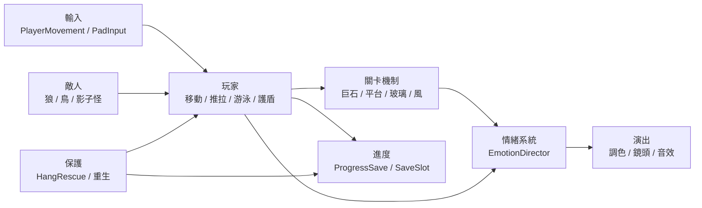

<div align="center">

# 育言：我一直都在
### Yu-Yan: I'll Always Be by Your Side

**把「說不出口的情緒」做成可以走過去的關卡。**
一款以產後憂鬱為主題的 2D 橫向捲軸敘事冒險遊戲。


<a href="#下載遊玩"></a>
<a href="#操作"></a>
<a href="#關卡"></a>
<a href="#技術架構"></a>
<a href="#開發指南"></a>
<a href="#常見問題"></a>

</div>

https://github.com/user-attachments/assets/6a8a383b-0c4f-4167-8570-9d12ffea02b7

---

## 專案簡介

產後憂鬱不只影響媽媽的心理健康，也會影響伴侶之間的關係與互動。這些情緒上的困難很難被身邊的人看見，伴侶也就不知道該如何理解與陪伴。

《育言：我一直都在》是一款 2D 橫向捲軸敘事冒險遊戲。玩家扮演被情緒困住的主角，穿過被追趕的廢墟、起風的荒原、沉入水下的世界與碎裂的玻璃館。

遊戲不直接說教，而是讓玩家親自走一遍：

- 推不上去的巨石、追在身後的狼，是「怎麼努力都撐不住」的感受
- 一路墜落、找不到落點，是「失去支撐」的感受
- 碎裂的玻璃與鏡子，是「看不清自己」的感受

主要對象是年輕男性，以及產後媽媽的伴侶。希望玩家玩完之後，能多一點理解、陪伴與支持。

> 專題編號 NUTN-ILT-PRJ-116-05

## 設計理念

| 原則 | 說明 |
|---|---|
| **情緒即機制** | 每個玩法都對應一種心理感受，不為了難度而難 |
| **體驗優先於說明** | 先讓玩家感受到，再用繪本、語音與字幕補完 |
| **不懲罰、不卡關** | 失敗會被溫柔地接住，而不是讓玩家挫折退出 |
| **一定要玩得完** | 看門狗、安全位置、存檔槽保證不會因為崩潰丟失進度 |

## 下載遊玩

### Windows 完整版（建議）

1. 到 [Releases](../../releases) 或 itch.io 頁面下載 `YuYan_Windows.zip`
2. **整個解壓縮**，不要在 zip 裡直接執行
3. 執行 `YuYan.exe`

> 若出現 Windows SmartScreen，點「其他資訊」→「仍要執行」。

### 網頁試玩版（Unity Play）

提供快速試玩，但功能較少（沒有重開保護），第一次需要點一下頁面才會開始播放背景影片。完整體驗請用 Windows 版。

### 系統需求

| | 最低 |
|---|---|
| 作業系統 | Windows 10 64 位元 |
| 顯示 | 支援 DirectX 11 或 12 |
| 硬碟 | 約 1.4 GB |
| 輸入 | 鍵盤，或 Xbox / PlayStation / Switch Pro 手把 |

## 操作

| 動作 | 鍵盤 | 手把（Xbox 命名） |
|---|---|---|
| 左右移動 | `A` / `D` | 左搖桿、十字鍵 |
| 跳躍、游泳上浮 | `Space` | `A` |
| 抓住、推拉物件 | `Shift`（按住） | `X`（按住） |
| 護盾 | `Q` | `B` |
| 點燭火 | `S`（落地時） | `Y` |
| 游泳下沉、硬撐 | `S` | 左搖桿下、十字鍵下 |
| 選單返回 | `Esc` | `Start` |
| 卡住時回主選單 | 長按 `Backspace` | — |

PlayStation 與 Switch Pro 手把按鍵位置相同（Unity Input System 自動對應）。

遊戲內的操作提示（背景線條畫與文字）會依你**最後使用的輸入裝置**自動切換：動鍵盤或滑鼠顯示 WASD、Shift、空白鍵；動手把顯示搖桿與 A / X / Y 按鈕。手把版線條畫由 `Tools/make_pad_hints.py` 從鍵盤版產生。

## 關卡

| 場景 | 主題 | 主要機制 |
|---|---|---|
| `MainMenuScene` | 主選單 | 存檔槽、繼續遊戲、設定 |
| `Book` | 命運之書 | 繪本翻頁敘事、漫畫格 |
| `CottonCastle` | 棉花堡 | 推拉方塊、踏階、機關 |
| `Ruined` | 廢墟 | 雲層墜落、狼群追逐、斜坡推巨石、風暴 |
| `desert` | 荒原 | 風推、鳥群攻擊、光球導引、日夜變化 |
| `underwater` | 水下 | 游泳、氣泡、光圈導引、日誌卡 |
| `dark glasses` | 玻璃館 | 追逐、碎裂地板、燭火反擊、鏡牆、結局 |

## 技術架構

### 技術棧

| 項目 | 內容 |
|---|---|
| 引擎 | Unity 6（6000.4.0f1） |
| 渲染 | Universal Render Pipeline（URP），2D 側視 |
| 語言 | C# |
| 輸入 | Input Manager + Input System（`PadInput` 統一封裝） |
| 鏡頭 | Cinemachine |
| 動畫 | Mixamo、程式驅動的 Sprite 動畫 |
| 後處理 | URP Volume（情緒調色、墜落漸變） |
| 文字 | TextMeshPro（中文字型） |
| 開發輔助 | Claude Code、ChatGPT / Codex、Google Antigravity |
| Unity 自動化 | Model Context Protocol（MCP） |

專案規模：C# 腳本 260+ 個、約 8 萬行。

### 目錄結構

```
Assets/
├─ Codes/          遊戲邏輯
│  ├─ FateBook/    命運之書（繪本敘事）
│  └─ Editor/      編輯器專用工具
├─ Editor/         打包與編輯器工具（WebGLSlimBuild 等）
├─ Scenes/         場景
├─ Resources/      執行時載入的資源（線條畫提示等）
├─ Animations/     動畫
├─ Shaders/        著色器
├─ Fonts/          字型
└─ ...             角色、怪物、場景美術
```

### 系統總覽



### 重點系統

| 系統 | 主要腳本 | 說明 |
|---|---|---|
| 玩家控制 | `PlayerMovement` | 斜坡貼合、推拉質量減速、風推與障礙判定、游泳、墜落 |
| 手把輸入 | `PadInput` | 新舊輸入系統雙路備援，沒接手把時完全不影響鍵盤 |
| 狼 AI | `WolfEnemy`、`WolfSpriteAnimator` | 追逐、回頭退後（「123 木頭人」）、高度追蹤限制 |
| 巨石挑戰 | `BoulderChallengeController`、`RollingRockVisual` | 坡上推石、被咬扣口數、失敗重置、外觀貼合 |
| 情緒演出 | `EmotionDirector`、`EmotionColorGradeFX`、`BreathPulseFX` | 依墜落與緊張程度連續調色、呼吸、心跳 |
| 玻璃館 | `GlassShatterFX`、`BreakableGlassFloor`、`CandleVoiceDirector` | 碎裂地板、燭火反擊、追逐節奏導演 |
| 命運之書 | `FateBook/*`、`StoryCardPlayer` | 繪本頁、漫畫格、第一次死亡演出 |
| 存檔 | `ProgressSave`、`SaveSlot`、`PersistentState` | 多槽存檔、安全位置、冷啟動繼續 |
| 場景切換 | `SceneTransitionController`、`ScenePreloader` | 預載、轉場、跨關卡接力 |

## 穩定性與保護機制

| 機制 | 作用 |
|---|---|
| **緊急救援**（`HangRescue`） | 背景看門狗偵測整個遊戲停住，自動重開並從上次進度繼續（Windows） |
| **逃生操作** | 長按 `Backspace` 回主選單 |
| **智慧重生**（`PlayerRespawnSystem`） | 卡住只搬人到安全位置，死亡才重置進度，不浪費玩家進度 |
| **安全位置**（`PlayerSafeSpot`） | 持續記錄安全落點，救援時送回 |
| **存檔槽**（`SaveSlot`） | 多槽存檔，重開後可繼續 |
| **網頁版保護** | 以 `UNITY_WEBGL` 條件編譯關閉不適用的功能（背景執行緒、重開程序），不影響 exe |

## 開發指南

### 環境

- [Unity Hub](https://unity.com/download) 與 Unity **6000.4.0f1**（版本請完全一致，避免場景被升級改寫）
- Git
- Windows 10 / 11

### 取得專案

```bash
git clone https://github.com/lilwad-0730/Graduation_project.git
```

1. 用 Unity Hub 開啟專案資料夾，等第一次匯入完成（可能要幾分鐘）
2. 開啟 `Assets/Scenes/MainMenuScene.unity`
3. 按 Play

### 編輯器內快速測試

開發版與編輯器有測試模式（`TesterMode`、`TesterKeys`），可跳關、無敵、傳送，正式版不含。

### 程式規範

- 一個檔案一個主要類別，檔名與類別同名
- 只在編輯器或開發版才需要的程式，用 `#if UNITY_EDITOR` 或 `DEVELOPMENT_BUILD` 包起來
- 網頁版不支援的 API（`Thread`、`Process`），用 `#if UNITY_WEBGL` 隔開
- 新增功能請附開關，方便出問題時關掉回到原本行為

## 打包與發佈

### Windows

Unity：`File` → `Build Profiles` → `Windows`，**不勾** Development Build。
打包後把輸出資料夾（排除 `*_BurstDebugInformation_DoNotShip`）壓成 zip 即可發佈。

### WebGL（Unity Play）

1. 用 `Assets/Editor/WebGLSlimBuild.cs` 的 `ApplySlim` 套用貼圖瘦身
2. 切換到 WebGL 平台並打包
3. 打包完成後，工具會自動把影片複製進輸出資料夾的 `StreamingAssets`
4. 打完用 `git checkout` 還原被改的貼圖設定，避免影響 exe
5. 上傳時壓縮 `Build`、`StreamingAssets`、`TemplateData`、`index.html` 四項

網頁版限制：沒有背景執行緒、無法重開程序；背景影片因瀏覽器政策需點一下頁面才會播放。

## 協作流程

- 以 GitHub 為中心，成員各自開發，合併回 `main`
- 提交前先 `git fetch`，確認遠端有沒有新內容再合併
- 場景檔（`.unity`）容易衝突，改場景前先在群組溝通
- Commit 訊息用中文，說明「改了什麼、為什麼」
- 不要提交 `Library/`、`Temp/`、`Logs/`、`UserSettings/` 與打包輸出

## 常見問題

**Q：遊戲打開後畫面卡住？**
長按 `Backspace` 回主選單。Windows 版若整個停住超過一段時間，會自動重開並從上次進度繼續。

**Q：手把沒反應？**
先確認 Windows 有認到手把。若按鍵位置不對，請回報手把型號。

**Q：網頁版主選單背景是黑的？**
瀏覽器要求使用者互動才能播放影片，請點一下頁面任意位置。

**Q：存檔在哪？**
在系統的 `Application.persistentDataPath`（Windows 為使用者資料夾下的 `AppData/LocalLow`）。

**Q：開專案時一直重新匯入很久？**
第一次匯入貼圖與字型會比較久，之後有快取就會變快。請確認 Unity 版本一致。

## 路線圖

- [x] 七個主要場景與完整流程
- [x] 鍵盤與手把操作
- [x] 看門狗、安全位置、多存檔槽
- [x] Windows 與 WebGL 發佈
- [ ] 更多實機手把與低階電腦測試
- [ ] 效能最佳化（記憶體、貼圖壓縮）
- [ ] 英文與多語系

## 團隊

| 成員 | 負責 |
|---|---|
| 陳修毅 | 程式 |
| 江啟強 | 企劃 |
| 王翊安 | 美術 |

## 授權

© 2026 《育言：我一直都在》專題團隊，保留所有權利（All Rights Reserved）。

本專案為畢業專題作品，原始碼與遊戲內容僅供展示與學術交流，未經同意請勿轉載、改作或商用。

專案中使用的第三方資源（Mixamo 角色動畫、Tripo AI 生成的 3D 模型、字型、Unity 套件等）各自遵循其原本的授權條款。

---

<div align="center">

**《育言：我一直都在》** ・ 陪伴，是最好的語言。

</div>
